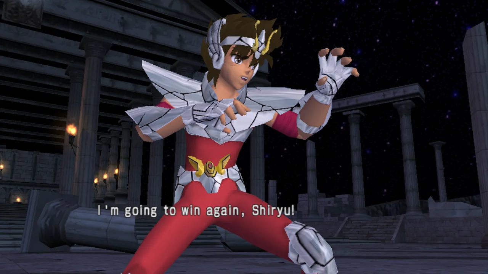

# Saint Seiya: The Hades — native port and decompilation

**English** · [Português](README.pt-BR.md)

[](https://playported.com/ports/1243-saint-seiya-the-hades/)
[](https://github.com/matpdev/SaintSeiyaRecomp/actions/workflows/ci.yml)

A native PC (Linux and Windows) port of **Saint Seiya: The Hades** (PS2, Europe, SLES-54162, and the Japanese
release, Meiou Hades Juunikyuu-hen, SLPS-25744), made by static
recompilation, with a matching decompilation moving forward alongside it. Modelled on
[Tenkaichi3Decomp](https://github.com/z3xox/Tenkaichi3Decomp).

This repository contains no game data (disc image, models, textures, sounds): `generated/` holds the game's code
translated to C, which reads everything else from your own disc. You need your own copy of the disc.



How it was made: [widescreen without symbols](https://sidequest-lab.dev/blog/saint-seiya-widescreen/) and
[a week of performance work and debugging](https://sidequest-lab.dev/blog/saint-seiya-semana-de-ajustes/).

## Status

The game **runs natively**: title screen, menus, story mode and fights, with music, voices, sound effects,
controller and memory card.

| Part | Status |
|---|---|
| Matching build | `SLES_541.62` rebuilt **byte for byte** from the assembly splat generates |
| Recompiler | all 13,855 functions of the executable translated from MIPS R5900 to C (`tools/recomp/`) |
| CPU / kernel | 128-bit registers, the PS2's FPU, VU0 macro mode; threads, semaphores, interrupts, timers |
| IOP | SIF/RPC, disc reads from the ISO, controller (PADMAN), CRI ADXI (sound); the game's sound driver (SSD/RSSD) runs as it is, on an IOP MIPS interpreter with an emulated SPU2; memory card (libmc2) on a folder |
| Graphics | DMAC → VIF → GIF → GS on its own thread; Vulkan renderer (SDL3 GPU) and a software GS; VU1 programs translated to native code |
| Image | 16:9 widescreen (wider 3D view, HUD and menus kept in their 4:3 shapes; F2 for the original 4:3), internal resolution that follows the window, supersampling, anisotropic filtering, texture packs |
| Frame rate | 60 Hz (the game's own NTSC mode, keeping the European region); frames interpolated between the game's, unlimited (or vsync, F4) |
| Sound | music and voices (CRI ADX) and **sound effects** (hits, footsteps, menus: the disc's SSD/RSSD driver, interpreted, playing on an emulated SPU2), with the SPU2's reverb |
| Video | the opening video (Sofdec), decoded with FFmpeg |
| Text | the game's texts drawn with a font file at 4x (M PLUS Rounded 1c, downloaded into `fonts/` by `build.sh` / `tools/fetch_font.sh`), in the game's own layout and colours |
| Extras | a training mode the original doesn't have (F5: idle opponent, infinite life, damage and inputs on screen); a second gamepad plays as player 2 |
| Decompilation | compiler identified (Metrowerks CodeWarrior PS2 3.0.1, `-O3`, C++), 327 library functions named; no game function decompiled yet |
| Memory card | slot 1 is a folder (`~/.local/share/sstheh/memcard1`): the game saves and loads normally |
| Missing | full playthrough testing, macOS; the Windows build is tested with Wine only so far |

Details in [`docs/roadmap.md`](docs/roadmap.md) and [`docs/recon.md`](docs/recon.md).

## Playing (the port only)

You need **your own copy** of the game: Saint Seiya: The Hades, **European release (SLES-54162)** or **Japanese
release (SLPS-25744, Meiou Hades Juunikyuu-hen, 2007)**: one executable plays both, the disc picks. None of the
game's data is in this repository. The Brazilian fan translation is a different build (SjCRUNCH-compressed) and
does not work.

**Ready to play:** the [releases](https://github.com/matpdev/SaintSeiyaRecomp/releases) have a Windows zip and a Linux
AppImage. Open the setup (`SaintSeiyaDecomp-setup.exe`, or the AppImage), choose your ISO, and play: nothing to
build. To build it yourself instead:

### 1. Requirements (Linux x86-64)

- GCC, Python 3, `glslc` (the `shaderc` package), SDL3 (3.2 or newer), a Vulkan driver, FFmpeg's
  libraries (for the opening video; without them it is skipped) and FreeType (for the texts in HD; without it
  they keep the disc's font)
  - Arch: `sudo pacman -S gcc python shaderc sdl3 vulkan-icd-loader ffmpeg freetype2` (plus your GPU's driver)
  - Debian/Ubuntu: `sudo apt install gcc python3-venv glslc libsdl3-dev libvulkan1 libavformat-dev libavcodec-dev libswscale-dev libswresample-dev libfreetype-dev`
- the game's code is translated to C from its executable (`tools/recomp/recomp.py` into `generated/recomp/`,
  the VU1 programs by a first executable, `build/sstheh-stage1`, into `generated/vu/`) and built into
  `build/sstheh`: playing needs no compiler. Without `disc/SLES_541.62` the port is built from `generated/` as it is. The build
  targets any x86-64 PC of the last ~12 years (`x86-64-v2`); `python3 configure.py --march=native` builds
  for this one only (about 4% faster VU1)

### 2. Build and play

Make an ISO image of your disc (for instance with `dd if=/dev/sr0 of=game.iso`, or any tool you like), then:

```sh
git clone https://github.com/matpdev/SaintSeiyaRecomp.git && cd SaintSeiyaRecomp
./build.sh /path/to/game.iso      # build; with no argument, a window opens to pick the ISO
./play.sh                         # play (rebuilds by itself when the code changed)
./play.sh --shortcut              # optional: an icon in the applications menu
```

`build.sh` checks the dependencies (and prints the command to install what is missing), verifies
the ISO by the executable's SHA-1, prepares `disc/`, creates the Python environment in `.venv` and builds
`build/sstheh`. The first build takes a few minutes. `./build.sh --clean` rebuilds from scratch.
`play.sh` runs the game. (`compilar.sh` and `jogar.sh`, the old names, still work.)

<details><summary>Manual steps (what the scripts do)</summary>

```sh
cp /path/to/game.iso disc/game.iso               # or: ln -s /path/to/game.iso disc/game.iso
7z e disc/game.iso SLES_541.62 -odisc/           # or: bsdtar -xf disc/game.iso -C disc SLES_541.62
sha1sum disc/SLES_541.62                         # must be 7ba6b0a1c05a94f28452840fcb73c204e46e79e6
python3 -m venv .venv
.venv/bin/pip install 'splat64[mips]' spimdisasm rabbitizer ninja-syntax pyyaml pyelftools ninja
.venv/bin/python configure.py                    # runs splat and writes build.ninja
PATH=$PWD/.venv/bin:$PATH ninja port             # builds build/sstheh
./build/sstheh                                   # run it from the repository folder
```

</details>

On the first run the game asks for the language and warns that there is no save on the memory card. To save:
Options → Save/Load (answer "Yes" to create the save). The memory card in slot 1 is the folder
`~/.local/share/sstheh/memcard1`: the save goes to `BESLES-54162GX/` and is loaded by itself when the game starts.

### Windows

The port also builds for Windows (64-bit, Vulkan), cross-compiled from Linux with MinGW-w64: `tools/win_deps.sh`
fetches SDL3, FFmpeg and builds FreeType into `tools/win/`; after the Linux build, `python3 configure.py --no-split
--windows && ninja -f build-win.ninja` makes `build-win/sstheh.exe`, and `tools/release.sh windows` the release
zip (`dist/SaintSeiyaDecomp-windows-x64.zip`: the game, the setup with Qt 6's llvm-mingw build from `tools/win/qt`,
the libraries' licenses). On Windows the settings and the memory card are in `%APPDATA%\sstheh`. Tested with Wine.

### Linux release (AppImage)

`tools/release.sh linux` makes `dist/SaintSeiyaDecomp-x86_64.AppImage` (about 90 MB) in a Debian 13 container
(Docker; glibc 2.41: it runs on the distributions of 2025 on), from the C the Linux build generated, with the
setup and the libraries the two need. The first time it opens the setup (`--setup` opens it again); the disc
image, the font and the settings go to `~/.local/share/sstheh`, where the game looks for them. Built with Debian's
SDL 3.2, the AppImage has no texture packs (PNG needs SDL 3.4).

### Checks and releases

Every push runs [CI](.github/workflows/ci.yml) on GitHub: the port's own code compiled for Linux and Windows
(warnings are errors), the setup, the Python tools (`tools/ci_check.sh linux|windows|python` does the same
locally). A push to `master` that passes gets the next version (`v0.1.0`, `v0.1.1`...; `#minor` or `#major` in a
commit message bumps that number instead) and a release with the Windows zip and the AppImage, built on GitHub
from the repository alone (`tools/release.sh windows|linux`, the same here). The game's code is in `generated/`;
when the translator changes, build with your disc and commit what changed there. No game data goes through
GitHub.

### The release's setup

`tools/setup/` is the setup of the prebuilt release (Qt 6): it checks the player's disc image (the executable must be
the one the port was translated from; the whole image is compared with the Redump dump only to tell), copies it
into `disc/` next to the game, downloads the font, keeps the widescreen choice, can make a shortcut, and starts
the game. `SaintSeiyaDecomp-setup --install <image.iso> [--no-font] [--no-shortcut] [--4-3]` does it without a
window. Build: `cmake -S tools/setup -B build/setup && cmake --build build/setup`. The game finds `disc/` in the
folder it is run from, else next to its executable (or one folder up).

### Controls

| Key | PS2 button |
|---|---|
| Arrows | D-pad |
| Z / X / A / S | ✕ / ○ / □ / △ |
| Q / W / E / R | L1 / R1 / L2 / R2 |
| Enter / Backspace | Start / Select |
| F1 | window size: 1280×720, 1600×900, 1920×1080, … (the ones that fit the screen), then full screen; remembered |
| F2 | widescreen 16:9 (default) or the original 4:3; remembered |
| F3 | performance panel (logic and display fps, CPU use) |
| F4 | toggles vsync |
| F5 | training menu (also Select + Start on a gamepad): see below |

Gamepads are picked up when they are connected: the first plays with the keyboard as player 1, the second as player 2
(two-player modes, e.g. 1P vs 2P in 1,000 Days War).

### Training

In 1,000 Days War, ○ on the character select opens the game's mode menu, which now has **Training**: a 1P VS
COM fight with training mode on (choosing another mode there goes back to the F5 menu's choice).

F5 (or Select + Start) opens a menu over the game; it drives with the pad (↑/↓, ✕ changes, ○ closes) and its
choices are remembered. With *Training mode* on, in every fight:

- *Opponent (computer)*: idle — a computer-played fighter stands still (moves already started finish); or plays as usual;
- *Infinite life*: life comes back to full a second after the last hit, and a hit never knocks out;
- *Show damage*: each fighter's life, the last hit's damage and the combo's (damage and hits);
- *Show inputs*: player 1's inputs, newest first (direction in numpad notation, 5 = neutral, 6 = right), with the
  frames each was held.

Against a second player (second gamepad) the opponent is played by that pad.

The same menu has **Auto-mash (Big Bang)**, for every fight (training or not, story included): in a Big Bang
Counter's clash and when a fighter's life runs out (Athena calling them to stand up), the port presses ✕ ○ □ △
for the players, about 20 times a second; the counter's timing press (the button shown on the screen) stays yours.
**Revival (Athena)** off: a fighter whose life runs out is knocked out, without Athena's scene calling them to stand
up again (any fighter, story included). **Big Bang Counter** off: a Big Bang Attack can't be countered (the
computer never presses the button shown, nor do you), so it never turns into a clash.

### Options

`--iso <file>` (default `disc/game.iso`), `-q` / `-v` / `-vv` (log), `--shot N,M` (saves screenshots at those
vertical blanks, no window). Environment variables:

| Variable | Effect |
|---|---|
| `SSTHEH_VSYNC=1` | start with vsync (default: no fps limit) |
| `SSTHEH_WINDOW=WxH` | window size at start, e.g. `2560x1440`, or `full` (default: 1920x1080, or the last one chosen with F1) |
| `SSTHEH_WIDESCREEN=0` | original 4:3 picture (default: 16:9, a wider 3D view with menus and HUD kept in their 4:3 shapes; full-screen 4:3 art gets blurred sides; in fights the life bars reach the screen's edges) |
| `SSTHEH_WIDE_2D=0` | in widescreen, story scenes whose 2D layers are larger than the screen cut at the 4:3 edges with blurred sides, as before (default: the layers' real art at the sides) |
| `SSTHEH_WIDE_SELECT=0` | in widescreen, the character select's portrait strips as on the disc (default: longer, reaching the screen's edges) |
| `SSTHEH_WIDE_HUD=0` | in widescreen, the fight HUD (life bars, portraits, cosmo gauges) in the middle 4:3 instead of at the edges |
| `SSTHEH_SHOT_PRESENT=WxH` | `--shot` saves the picture as a window that size shows it (widescreen, sides) instead of the PS2 frame |
| `SSTHEH_FONT=file` / `=0` | the font the texts are drawn with (default: the first .ttf/.otf in `~/.local/share/sstheh/fonts/`, else `fonts/`) / the disc's font |
| `SSTHEH_TEX_DUMP=1` | save every texture the game uses as PNG in `~/.local/share/sstheh/textures/dump/` (or `dump/` in the `SSTHEH_TEXTURES` folder) |
| `SSTHEH_RAM_DUMP=1` | `--shot` also saves the EE's 32 MB as `build/ram_N.bin` (for finding the game's variables) |
| `SSTHEH_TEXTURES=0` | don't use replacement textures (`~/.local/share/sstheh/textures/<name>.png`, any size; `tools/upscale_textures.sh` makes an HD pack with Real-ESRGAN) |
| `SSTHEH_SCALE=n` | fixed render scale (1 to 8; default: follows the window size — 4 at 1080p, 5 at 4K) |
| `SSTHEH_INTERP=0` | no interpolated frames (only the game's own) |
| `SSTHEH_50HZ=1` | original PAL mode (50 Hz) |
| `SSTHEH_30FPS_SCENES=1` | menus and 2D screens at 30 fps, as on the disc |
| `SSTHEH_PAD2=1` | a controller in port 2 even without a second gamepad (two-player modes) |
| `SSTHEH_AUTOMASH=1` / `=0` | auto-mash in Big Bang events on / off, for this run (default: the F5 menu's choice) |
| `SSTHEH_REVIVAL=0` / `=1` | revivals (Athena) off / on, for this run (default: the F5 menu's choice, on) |
| `SSTHEH_BBCOUNTER=0` / `=1` | Big Bang Counters off / on, for this run (default: the F5 menu's choice, on) |
| `SSTHEH_TRAINING=1` / `=0` | training mode with every option on / off, for this run (default: the choices made in the F5 menu) |
| `SSTHEH_UNLOCK_ALL=1` | cheat: unlocks everything (modes, characters, stages, extras); kept in the save once saved |
| `SSTHEH_MEMCARD=folder` | where the memory card lives (default `~/.local/share/sstheh/memcard1`) |
| `SSTHEH_AUDIO=0` | no sound |
| `SSTHEH_RSSD_HLE=1` | don't run the sound effects driver (music and voices only, as before) |
| `SSTHEH_AUDIO_DUMP=a.wav`, `SSTHEH_SPU_DUMP=b.raw` | record the sound (the mix as WAV; the SPU2 alone as 16-bit stereo 48 kHz PCM) |
| `SSTHEH_GS=sw` | software GS instead of Vulkan (slow) |
| `SSTHEH_VUJIT=0`, `SSTHEH_GSTHREAD=0`, `SSTHEH_UPLOAD_DEDUP=0` | turn optimizations off (to compare when something looks wrong) |
| `SSTHEH_PERF_LOG=1` | print what the F3 panel shows to the terminal |
| `SSTHEH_VUREC=file` | record 20 vertical blanks of VU1 programs (from `SSTHEH_VUREC_FROM`, default 8000) for `tools/vubench.c`, which checks and times their translation |
| `SSTHEH_GSREC=file` | record the GS thread's work: its state, then everything it is given for `SSTHEH_GSREC_FRAMES` pictures shown (150) from vertical blank `SSTHEH_GSREC_FROM` (9000). `build/sstheh --gs-replay file [warm]` replays it without the game: time per frame and a hash of what is drawn (run it from `build/`, where the VU1 programs are found) |

### Known issues

- if something breaks, run with `-v` and attach the log to the report, with what you were doing at the time

## Decompilation (matching build)

To work on the decompilation, install the full toolchain (Metrowerks compilers, ee-gcc 2.96 and R5900
binutils):

```sh
tools/setup.sh                       # wibo, compilers, R5900 binutils, Python venv
.venv/bin/python configure.py
PATH=$PWD/.venv/bin:$PATH ninja      # matching build: "OK: build matches the original"
```

ee-gcc 2.96 is an i386 binary: 32-bit program support is needed.

## Layout

How the parts fit together: [docs/architecture.md](docs/architecture.md); debugging options and tools:
[docs/debugging.md](docs/debugging.md).


| Path | |
|---|---|
| `config/sles_541.62.yaml` | splat configuration (segments, `$gp`) |
| `config/symbol_addrs.txt` | known names (`name = 0xADDRESS; // type:func`) |
| `asm/`, `assets/` | generated by splat (ignored by git) |
| `generated/` | the game's code translated to C: `recomp/` (the MIPS code, `tools/recomp/recomp.py`), `vu/` (the VU1 programs); rebuilt from `disc/SLES_541.62` when there is one |
| `config/jp/`, `generated-jp/` | the Japanese release: its splat configuration, `hle.txt` and translated code (rebuilt from `disc/SLPS_257.44`); its addresses are the second column of `port/hle/game.h`, found with `tools/version_map.py` |
| `src/`, `include/` | decompiled code (C++) |
| `tools/recomp/` | static MIPS → C recompiler |
| `port/runtime/`, `port/kernel/` | CPU, memory, timers, kernel syscalls |
| `port/iop/`, `port/hle/` | IOP services and SDK functions replaced by native ones (listed in `port/hle.txt`); `port/hle/game.h` names every game address the port uses |
| `port/iop/lle/` | IOP modules running as they are: MIPS I interpreter, IRX loader, native system modules, SPU2 |
| `port/gs/` | DMA, VIF, VU, GS and the Vulkan renderer |
| `build.sh`, `play.sh`, `tools/disc.py` | build from your ISO, play; disc check |
| `tools/fdiff.py` | compiles a `.cpp` and compares each function with the original |
| `tools/recon/` | reconnaissance scripts (compiler classification, cross references) |
| `tools/icon/` | the game's icon as SVG; `make.sh` makes the Windows `.ico` and the PNGs of the AppImage and the setup from it |

## Contributing

See [`CONTRIBUTING.md`](CONTRIBUTING.md). You can help by decompiling functions, improving the port, or just
playing and reporting what breaks.

## Licenses

The code in this repository is under the MIT license ([`LICENSE`](LICENSE)). It does not cover the game, which is
not included and belongs to its owners. Parts of the renderer come from Tenkaichi3Decomp (MIT, in `licenses/`). The Metrowerks compilers are
proprietary software archived by decomp.me; use them only if you are entitled to.
