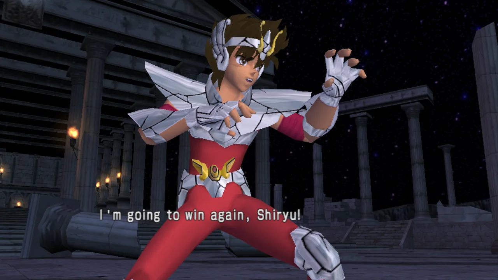

# Saint Seiya: The Hades — port nativo e decompilação

[English](README.md) · **Português**

Port nativo para PC (Linux) de **Saint Seiya: The Hades** (PS2, Europa, SLES-54162), feito por
recompilação estática, com uma decompilação matching avançando em paralelo. O modelo é o
[Tenkaichi3Decomp](https://github.com/z3xox/Tenkaichi3Decomp).

Este repositório não contém nada do jogo. Você precisa da sua própria cópia do disco.



Como foi feito: [widescreen sem símbolos](https://sidequest-lab.dev/pt/blog/saint-seiya-widescreen/) e
[uma semana de performance e depuração](https://sidequest-lab.dev/pt/blog/saint-seiya-semana-de-ajustes/).

## Estado

O jogo **roda nativamente**: tela de título, menus, modo história e lutas, com música, vozes, efeitos sonoros,
controle e memory card.

| Parte | Estado |
|---|---|
| Build matching | `SLES_541.62` reconstruído **byte a byte** a partir do assembly gerado pelo splat |
| Recompilador | as 13.855 funções do executável traduzidas de MIPS R5900 para C (`tools/recomp/`) |
| CPU / kernel | registradores de 128 bits, FPU do PS2, VU0 em modo macro; threads, semáforos, interrupções, timers |
| IOP | SIF/RPC, leitura do disco a partir do ISO, controle (PADMAN), CRI ADXI (som); o driver de som do jogo (SSD/RSSD) roda como está, num interpretador MIPS do IOP com SPU2 emulado; memory card (libmc2) sobre uma pasta |
| Gráficos | DMAC → VIF → GIF → GS em thread própria; renderer Vulkan (SDL3 GPU) e GS em software; programas de VU1 traduzidos para código nativo |
| Imagem | widescreen 16:9 (3D mais largo, HUD e menus nas proporções 4:3; F2 volta ao 4:3 original), resolução interna que acompanha a janela, supersampling, filtro anisotrópico, pacotes de texturas |
| Taxa de quadros | 60 Hz (modo NTSC do próprio jogo, com a região europeia); quadros interpolados entre os do jogo, sem limite (ou vsync, F4) |
| Som | música e vozes (CRI ADX) e **efeitos sonoros** (golpes, passos, menus: o driver SSD/RSSD do disco, interpretado, tocando num SPU2 emulado), com o reverb do SPU2 |
| Vídeo | o vídeo de abertura (Sofdec), decodificado com FFmpeg |
| Texto | os textos do jogo desenhados com um arquivo de fonte a 4x (M PLUS Rounded 1c, baixada para `fonts/` pelo `build.sh` / `tools/fetch_font.sh`), no layout e nas cores do próprio jogo |
| Extras | um modo de treino que o original não tem (F5: oponente parado, vida infinita, dano e inputs na tela); um segundo controle joga como jogador 2 |
| Decompilação | compilador identificado (Metrowerks CodeWarrior PS2 3.0.1, `-O3`, C++), 327 funções de biblioteca nomeadas; nenhuma função do jogo decompilada ainda |
| Memory card | o slot 1 é uma pasta (`~/.local/share/sstheh/memcard1`): o jogo salva e carrega normalmente |
| Falta | testes do começo ao fim, Windows/macOS |

Detalhes técnicos (em inglês) em [`docs/roadmap.md`](docs/roadmap.md) e [`docs/recon.md`](docs/recon.md).

## Jogar (só o port)

Você precisa da **sua própria cópia** do jogo: Saint Seiya: The Hades, **versão europeia (SLES-54162)**. Nada do
jogo está neste repositório. A tradução brasileira de fãs é outro build (comprimido com SjCRUNCH) e não serve.

### 1. Requisitos (Linux x86-64)

- GCC, Python 3, `ninja`, `glslc` (pacote `shaderc`), SDL3 (3.2 ou mais nova), um driver Vulkan, as
  bibliotecas do FFmpeg (para o vídeo de abertura; sem elas ele é pulado) e o FreeType (para os textos em HD; sem
  ele ficam com a fonte do disco)
  - Arch: `sudo pacman -S gcc python ninja shaderc sdl3 vulkan-icd-loader ffmpeg freetype2` (mais o driver da sua placa)
  - Debian/Ubuntu: `sudo apt install gcc python3-venv ninja-build glslc libsdl3-dev libvulkan1 libavformat-dev libavcodec-dev libswscale-dev libswresample-dev libfreetype-dev`
- o GCC também é usado para os programas de VU1 do jogo: eles são compilados para código nativo a partir do
  executável, antes de jogar (`build/sstheh --compile-vu`, que o `build.sh` roda, uns 20 s), e guardados em
  `~/.cache/sstheh/vu`; os que faltarem são compilados em segundo plano quando o jogo abre

### 2. Compilar e jogar

Faça uma imagem ISO do seu disco (por exemplo com `dd if=/dev/sr0 of=game.iso` ou o programa que preferir) e:

```sh
git clone https://github.com/matpdev/SaintSeiyaRecomp.git && cd SaintSeiyaRecomp
./build.sh /caminho/para/game.iso      # compila; sem argumento, abre uma janela para escolher a ISO
./play.sh                              # abre o jogo (e recompila sozinho se o código mudar)
./play.sh --shortcut                   # opcional: ícone no menu de aplicativos
```

O `build.sh` confere as dependências (e diz o comando para instalar o que faltar), valida a ISO pelo SHA-1 do
executável, prepara `disc/`, cria o ambiente Python em `.venv` e gera `build/sstheh`. A primeira compilação leva
alguns minutos. `./build.sh --clean` refaz tudo do zero. (`compilar.sh` e `jogar.sh`, os nomes antigos, continuam funcionando.)

<details><summary>Passo a passo manual (o que os scripts fazem)</summary>

```sh
cp /caminho/para/game.iso disc/game.iso          # ou: ln -s /caminho/para/game.iso disc/game.iso
7z e disc/game.iso SLES_541.62 -odisc/           # ou: bsdtar -xf disc/game.iso -C disc SLES_541.62
sha1sum disc/SLES_541.62                         # deve dar 7ba6b0a1c05a94f28452840fcb73c204e46e79e6
python3 -m venv .venv
.venv/bin/pip install 'splat64[mips]' spimdisasm rabbitizer ninja-syntax pyyaml pyelftools ninja
.venv/bin/python configure.py                    # roda o splat e gera build.ninja
PATH=$PWD/.venv/bin:$PATH ninja port             # gera build/sstheh
./build/sstheh                                   # rode de dentro da pasta do repositório
```

</details>

Na primeira execução o jogo pede o idioma e avisa que não há save no memory card. Para salvar: Options → Save/Load
(responda "Yes" para criar o save). O memory card do slot 1 é a pasta `~/.local/share/sstheh/memcard1`: o save fica
em `BESLES-54162GX/` e é carregado sozinho quando o jogo abre.

### Controles

| Tecla | Botão do PS2 |
|---|---|
| Setas | direcional |
| Z / X / A / S | ✕ / ○ / □ / △ |
| Q / W / E / R | L1 / R1 / L2 / R2 |
| Enter / Backspace | Start / Select |
| F1 | tamanho da janela: 1280×720, 1600×900, 1920×1080, … (os que cabem na tela), depois tela cheia; fica salvo |
| F2 | widescreen 16:9 (padrão) ou o 4:3 original; fica salvo |
| F3 | painel de desempenho (fps da lógica e da tela, uso de CPU) |
| F4 | liga/desliga o vsync |
| F5 | menu de treino (também Select + Start num gamepad): veja abaixo |

Controles de jogo (gamepad) são reconhecidos ao serem conectados: o primeiro joga junto com o teclado como jogador 1, o
segundo como jogador 2 (modos de dois jogadores, ex. 1P vs 2P na Guerra dos Mil Dias).

### Treino

F5 (ou Select + Start) abre um menu por cima do jogo; ele é usado com o controle (↑/↓, ✕ muda, ○ fecha) e as
escolhas ficam salvas. Com *Training mode* ligado, em toda luta:

- *Opponent (computer)*: idle — um lutador jogado pelo computador fica parado (golpes já começados terminam); ou joga normalmente;
- *Infinite life*: a vida volta ao máximo um segundo depois do último golpe, e nenhum golpe nocauteia;
- *Show damage*: a vida de cada lutador, o dano do último golpe e o do combo (dano e golpes);
- *Show inputs*: os comandos do jogador 1, o mais novo em cima (direção na notação do teclado numérico, 5 = neutro,
  6 = direita), com os quadros que cada um durou.

Contra um segundo jogador (segundo gamepad), o oponente é jogado por esse controle.

O mesmo menu tem **Auto-mash (Big Bang)**, para toda luta (treino ou não, história incluída): na disputa do Big Bang
Counter e quando a vida de um lutador acaba (Atena chamando para levantar), o port aperta ✕ ○ □ △ pelos jogadores,
cerca de 20 vezes por segundo; o toque no tempo do contra-ataque (o botão mostrado na tela) continua seu.
**Revival (Athena)** desligado: o lutador cuja vida acaba é nocauteado, sem a cena de Atena chamando para levantar
(qualquer lutador, história incluída).

### Opções

`--iso <arquivo>` (padrão `disc/game.iso`), `-q` / `-v` / `-vv` (log), `--shot N,M` (salva capturas nos vblanks
indicados, sem janela). Variáveis de ambiente:

| Variável | Efeito |
|---|---|
| `SSTHEH_VSYNC=1` | começa com vsync (padrão: sem limite de fps) |
| `SSTHEH_WINDOW=LxA` | tamanho da janela ao abrir, ex. `2560x1440`, ou `full` (padrão: 1920x1080, ou o último escolhido com F1) |
| `SSTHEH_WIDESCREEN=0` | imagem 4:3 original (padrão: 16:9, o 3D com visão mais larga e menus e HUD nas proporções 4:3; artes 4:3 de tela cheia ganham laterais desfocadas; nas lutas, as barras de vida vão até as bordas) |
| `SSTHEH_WIDE_SELECT=0` | no widescreen, as faixas de retratos da seleção de personagens como no disco (padrão: mais longas, até as bordas da tela) |
| `SSTHEH_WIDE_HUD=0` | no widescreen, o HUD da luta (barras de vida, retratos, medidores de cosmo) no 4:3 do meio em vez de nas bordas |
| `SSTHEH_SHOT_PRESENT=LxA` | o `--shot` salva a imagem como uma janela desse tamanho mostra (widescreen, laterais) em vez do quadro do PS2 |
| `SSTHEH_FONT=arquivo` / `=0` | a fonte usada nos textos (padrão: o primeiro .ttf/.otf em `~/.local/share/sstheh/fonts/`, senão `fonts/`) / a fonte do disco |
| `SSTHEH_TEX_DUMP=1` | salva cada textura que o jogo usa como PNG em `~/.local/share/sstheh/textures/dump/` (ou `dump/` na pasta de `SSTHEH_TEXTURES`) |
| `SSTHEH_RAM_DUMP=1` | o `--shot` também salva os 32 MB do EE em `build/ram_N.bin` (para achar variáveis do jogo) |
| `SSTHEH_TEXTURES=0` | não usa texturas substitutas (`~/.local/share/sstheh/textures/<nome>.png`, de qualquer tamanho; `tools/upscale_textures.sh` gera um pacote HD com o Real-ESRGAN) |
| `SSTHEH_SCALE=n` | escala de renderização fixa (1 a 8; padrão: acompanha o tamanho da janela — 4 em 1080p, 5 em 4K) |
| `SSTHEH_INTERP=0` | sem quadros interpolados (mostra só os quadros do jogo) |
| `SSTHEH_50HZ=1` | modo PAL original (50 Hz) |
| `SSTHEH_30FPS_SCENES=1` | menus e telas 2D a 30 fps, como no disco |
| `SSTHEH_PAD2=1` | um controle na porta 2 mesmo sem segundo gamepad (modos de dois jogadores) |
| `SSTHEH_AUTOMASH=1` / `=0` | mash automático nos eventos de Big Bang ligado / desligado, só nesta execução (padrão: a escolha do menu F5) |
| `SSTHEH_REVIVAL=0` / `=1` | ressurreições (Atena) desligadas / ligadas, só nesta execução (padrão: a escolha do menu F5, ligadas) |
| `SSTHEH_TRAINING=1` / `=0` | modo de treino com todas as opções ligadas / desligadas, só nesta execução (padrão: as escolhas do menu F5) |
| `SSTHEH_UNLOCK_ALL=1` | cheat: libera tudo (modos, personagens, cenários, extras); salvando, fica no save |
| `SSTHEH_MEMCARD=pasta` | onde fica o memory card (padrão `~/.local/share/sstheh/memcard1`) |
| `SSTHEH_AUDIO=0` | sem som |
| `SSTHEH_RSSD_HLE=1` | não roda o driver de efeitos sonoros (só música e vozes, como antes) |
| `SSTHEH_AUDIO_DUMP=a.wav`, `SSTHEH_SPU_DUMP=b.raw` | grava o som (a mistura em WAV; só o SPU2 em PCM 16 bits estéreo 48 kHz) |
| `SSTHEH_GS=sw` | GS em software em vez de Vulkan (lento) |
| `SSTHEH_VUJIT=0`, `SSTHEH_GSTHREAD=0`, `SSTHEH_UPLOAD_DEDUP=0` | desligam otimizações (para comparar se algo sair errado) |
| `SSTHEH_PERF_LOG=1` | escreve no terminal o que o painel F3 mostra |
| `SSTHEH_VUREC=arquivo` | grava 20 vblanks de programas de VU1 (a partir de `SSTHEH_VUREC_FROM`, padrão 8000) para o `tools/vubench.c`, que confere e cronometra a tradução deles |
| `SSTHEH_GSREC=arquivo` | grava o trabalho da thread do GS: o estado dela e tudo o que ela recebe por `SSTHEH_GSREC_FRAMES` imagens mostradas (150) a partir do vblank `SSTHEH_GSREC_FROM` (9000). `build/sstheh --gs-replay arquivo [aquecimento]` repete isso sem o jogo: tempo por frame e um hash do que é desenhado (rode a partir de `build/`, onde os programas de VU1 estão) |

### Problemas conhecidos

- se algo quebrar, rode com `-v` e anexe o log ao relato, junto com o que estava fazendo na hora

## Decompilação (build matching)

Para trabalhar na decompilação, instale a cadeia completa (compiladores Metrowerks, ee-gcc 2.96 e binutils
R5900):

```sh
tools/setup.sh                       # wibo, compiladores, binutils R5900, venv Python
.venv/bin/python configure.py
PATH=$PWD/.venv/bin:$PATH ninja      # build matching: "OK: build matches the original"
```

O ee-gcc 2.96 é um binário i386: é preciso suporte a programas de 32 bits.

## Estrutura

| Caminho | |
|---|---|
| `config/sles_541.62.yaml` | configuração do splat (segmentos, `$gp`) |
| `config/symbol_addrs.txt` | nomes conhecidos (`nome = 0xENDEREÇO; // type:func`) |
| `asm/`, `assets/` | gerados pelo splat (ignorados pelo git) |
| `src/`, `include/` | código decompilado (C++) |
| `tools/recomp/` | recompilador estático MIPS → C |
| `port/runtime/`, `port/kernel/` | CPU, memória, timers, syscalls do kernel |
| `port/iop/`, `port/hle/` | serviços do IOP e funções do SDK substituídas por nativas (lista em `port/hle.txt`) |
| `port/iop/lle/` | módulos do IOP rodando como estão: interpretador MIPS I, carregador de IRX, módulos do sistema nativos, SPU2 |
| `port/gs/` | DMA, VIF, VU, GS e renderer Vulkan |
| `tools/fdiff.py` | compila um `.cpp` e compara cada função com o original |
| `tools/recon/` | scripts de reconhecimento (classificação de compiladores, referências cruzadas) |

## Contribuindo

Veja [`CONTRIBUTING.md`](CONTRIBUTING.md) (em inglês; issues e PRs em português também são bem-vindos). Dá para ajudar decompilando funções, melhorando o port ou só
testando e relatando o que quebra.

## Licenças

O código deste repositório está sob a licença MIT ([`LICENSE`](LICENSE)). Ela não cobre o jogo, que não está incluído e
pertence aos seus donos. Partes do renderer vêm do Tenkaichi3Decomp (MIT, em `licenses/`). Os compiladores Metrowerks são software
proprietário, arquivado pelo decomp.me; use-os só se tiver direito a eles.
